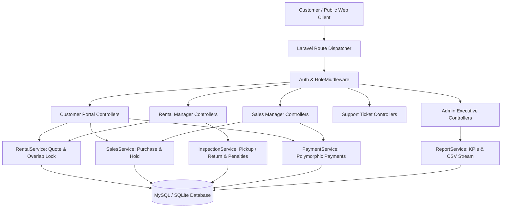

# AutoDrive — Premium Car Rental & Sales Management System

[](https://laravel.com)
[](https://php.net)
[](https://tailwindcss.com)
[](https://mysql.com)
[-success?style=for-the-badge)](tests/)

**AutoDrive** is a production-grade, enterprise-ready full-stack automotive rental and vehicle acquisition management platform built on Laravel 12, PHP 8.5, and Tailwind CSS v4. It features a cinematic, dark-themed public showroom, role-based workflows for 5 distinct business actors, concurrency-safe booking logic, return inspections with automatic late and damage penalties, title transfer billing, support ticket discussions, and executive intelligence reporting with streaming CSV export.

---

## Key Highlights & Architectural Strengths

- **Cinematic Visual Identity**: Built with a palette of deep carbon black (`#08090c`, `#0e1117`), metallic silver accents, and a restrained electric-blue glow (`#00e5ff`). Glassmorphism, specifications badges, interactive quote calculations, and zero visual clutter.
- **Role-Based Access Control (RBAC)**: Five distinct roles (**Administrator**, **Rental Manager**, **Sales Manager**, **Customer Support**, and **Customer**) managed through custom middleware with 1-click Demo Persona Switching.
- **Race Condition & Overlap Prevention**: Rental bookings and vehicle sales use atomic database transactions with row-level locks (`lockForUpdate()`) and compound date-range checks to eliminate overlapping confirmed bookings and duplicate vehicle sales.
- **Complete Rental Lifecycle**: Real-time quote engine (daily rate × days + $50/day insurance + 7% tax), manager approval workflow, digital pickup inspection (odometer & condition handover), return inspection with automated fee calculation, and automated release to available inventory or maintenance routing.
- **Complete Sales Lifecycle**: Customer purchase offers, Sales Manager vehicle reservation hold (`reserved` status), title transfer documentation, bill of sale execution, permanent lock to `sold`, and verified ledger payment recording.
- **Verified Financial Ledger**: Polymorphic payment records (`RentalBooking` & `SalesTransaction`), deposit tracking, balance-due computations, transaction reference generation, and print-ready official receipts (`/receipts/{payment}`).
- **Support Inquiry System**: Threaded conversation tickets between customers and concierge support staff with priority tracking and live status updates.
- **Executive Intelligence & Reporting**: Real-time KPI summaries, fleet category breakdown, booking distribution, and streaming CSV export for fleet inventory, rental ledgers, and sales transactions.

---

## System Architecture



---

## Entity Relationship Overview

The database consists of 14 normalized tables:
- **`users`**: Profiles, role enums, driver license numbers, phone, and credentials.
- **`vehicle_categories`**: Slugs, luxury badges, active state.
- **`vehicles`**: VIN, license plates, condition, listing type (`rental`, `sale`, `both`), status (`available`, `rented`, `reserved`, `sold`, `maintenance`), daily rate, and selling price.
- **`vehicle_images`**: Secondary photo gallery associated with each vehicle.
- **`rental_bookings`**: Booking numbers, date ranges, total days, itemized costs, balance due, compound index `[vehicle_id, status, start_date, end_date]`.
- **`rental_inspections`**: Pickup and return inspections, odometer logs, fuel levels, damage notes, late fees, and maintenance triggers.
- **`purchase_requests`**: Acquisition offers, offering price, status (`pending`, `approved`, `rejected`, `completed`).
- **`sales_transactions`**: Bill of sale, invoice numbers, tax, registration fees, paid amounts, payment status.
- **`payments`**: Polymorphic remittances (`payable_type`, `payable_id`) with unique references and staff verification metadata.
- **`support_tickets`** & **`support_messages`**: Customer service tickets and multi-party threaded messaging.
- **`activity_logs`**: System audit trail capturing administrative and operational events.

---

## Demo Accounts & Persona Switcher

You can instantly switch personas from the top navigation bar or via `/demo-login/{role}`:

| Role | Email | Password | Access Area |
|---|---|---|---|
| **Administrator** | `admin@autodrive.com` | `password` | `/admin/dashboard` & System-Wide |
| **Rental Manager** | `rental@autodrive.com` | `password` | `/rental/dashboard` |
| **Sales Manager** | `sales@autodrive.com` | `password` | `/sales/dashboard` |
| **Customer Support** | `support@autodrive.com` | `password` | `/support/dashboard` |
| **Verified Customer** | `customer@autodrive.com` | `password` | `/dashboard` & Marketplace |

---

## Quickstart & Installation Guide

### Prerequisites
- PHP 8.5+ with `pdo_mysql`, `sqlite3`, `curl`, `mbstring`, `fileinfo` extensions enabled.
- Composer 2.x
- Node.js 20+ & npm
- MySQL 8.0+

### Step-by-Step Setup

1. **Clone the repository:**
   ```bash
   git clone <repo-url>
   cd PROJECT
   ```

2. **Install PHP and Node dependencies:**
   ```bash
   composer install
   npm install
   ```

3. **Configure Environment:**
   Ensure `.env` exists and contains your database connection:
   ```env
   APP_NAME=AutoDrive
   APP_ENV=local
   APP_KEY=base64:...
   APP_DEBUG=true
   APP_URL=http://localhost:8000

   DB_CONNECTION=mysql
   DB_HOST=127.0.0.1
   DB_PORT=3306
   DB_DATABASE=autodrive_db
   DB_USERNAME=root
   DB_PASSWORD=
   ```

4. **Run Database Migrations and Seeders:**
   ```bash
   php artisan migrate:fresh --seed
   ```
   *This creates all 14 tables and seeds luxury vehicle categories, exotic fleet vehicles, vehicle galleries, sample bookings, sales transactions, support tickets, and role-based demo accounts.*

5. **Build Frontend Assets:**
   ```bash
   npm run build
   ```
   *(Or run `npm run dev` for hot module reloading during development)*

6. **Start the Local Development Server:**
   ```bash
   php artisan serve
   ```
   Open your browser at `http://localhost:8000`.

---

## Running Automated Tests

The application includes 45 comprehensive feature and unit tests with 183 assertions covering all critical business rules, security boundaries, and financial calculations:

```bash
# Run all tests with compact output
php artisan test --compact

# Run specific domain test suites
php artisan test --filter=RentalBookingTest
php artisan test --filter=SalesTransactionTest
php artisan test --filter=RentalInspectionTest
php artisan test --filter=PaymentTest
php artisan test --filter=VehicleSearchTest
php artisan test --filter=RoleAccessTest
php artisan test --filter=ReportTest
php artisan test --filter=SupportTicketTest
```

### Verified Test Matrix
- **`AuthTest`**: Customer registration, valid and invalid credentials, session destruction, and 1-click persona switching.
- **`RoleAccessTest`**: Strict middleware access enforcement preventing customers from accessing staff areas and isolating manager roles.
- **`VehicleSearchTest`**: Category, transmission, fuel, seat capacity, price filtering, brand keyword search, price sorting, and vehicle details view.
- **`RentalBookingTest`**: Accurate quote generation, date validation, overlap collision prevention with concurrency locking, and customer cancellation rules.
- **`RentalInspectionTest`**: Booking approval/rejection, departure pickup inspection, return inspection, automatic late fee penalties, damage billing, and maintenance routing.
- **`SalesTransactionTest`**: Purchase offers, reservation hold, sale finalization, bill of sale, and duplicate sale prevention.
- **`PaymentTest`**: Partial and full payment tracking, balance updates, and authorized access to printable official receipts.
- **`ReportTest`**: Executive metrics aggregation, inventory distribution, booking status charts, and streaming CSV export.
- **`SupportTicketTest`**: Customer inquiries, concierge staff replies, and status transitions.

---

## Code Quality & Standards

Code is formatted according to Laravel Pint guidelines:
```bash
vendor/bin/pint --format agent
```

---

## License

The AutoDrive platform is open-sourced software licensed under the [MIT license](https://opensource.org/licenses/MIT).
